# State machines

Every status lifecycle in the app is a Symfony Workflow `state_machine` declared in
`config/packages/workflow.yaml` - that file is the single source of truth. This page is
generated from it - re-run the command below after changing a workflow.

```bash
for w in booking payment booking_occurrence lesson waitlist_entry subscription refund_request customer_order cart promotion_redemption pricing_rule; do
  docker compose run --rm php bin/console workflow:dump $w --dump-format=mermaid
done
```

## How to work with them

- **Change a lifecycle**: edit `workflow.yaml` (places / transitions) and nothing else decides legality.
- **Drive a transition**: inject `App\Application\Workflow\StateMachinesInterface` and call `can()` / `apply()` /
  `applyIfPossible()` (the last one reproduces the old "silent no-op if illegal" behaviour).
  `Booking` and `Payment` keep their dedicated ports (`BookingStateMachineInterface`, `PaymentStateMachineInterface`).
- **Never** compare `->status` to string literals to decide whether something is allowed, and never call the
  `setStatus()` marking-store hooks directly - they only stamp bookkeeping (timestamps) for the transition.
- **Extra data** for a transition goes through workflow context (`['now' => ...]`) or a typed `record*()` call
  made right after `apply()` (e.g. `RefundRequest::recordDecision()`).
- **Test** with `tests/Application/Workflow/StateMachinesTest.php`.

## Not modelled as workflows (on purpose)

- `User` account lifecycle (`AccountLifecycle`): derived from nullable timestamps, there is no status column to mark.
- `Post` (`PostStatus`): a two-state draft/published toggle with no guards.
- `LessonModal::$paymentStatus`: transient UI state of one Live Component, not persisted domain state.

## Known gaps

- `Booking::STATUS_WAITING_APPROVAL` exists (approval flow, `Booking::approve()`) but is not a place of the `booking` workflow.
- `AdminChatTools` still calls `Booking::setStatus()` / `Payment::setStatus()` as a fallback when the workflow refuses.
- `AdminPricingRulesComponent`'s edit form assigns `PricingRule::$status` directly (any state to any state, so harmless today).

## Booking (`booking`)

Customer reservation (guards + notifications; port `BookingStateMachineInterface`)

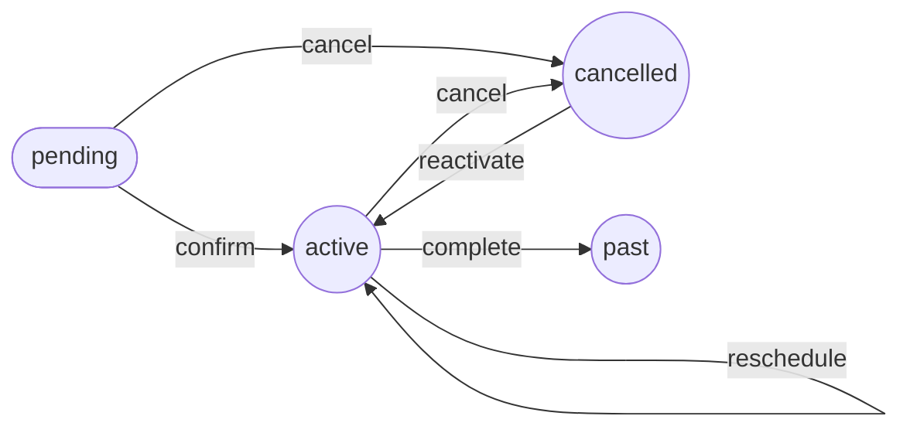

## Payment (`payment`)

Money owed/received (audit trail + metrics; port `PaymentStateMachineInterface`)

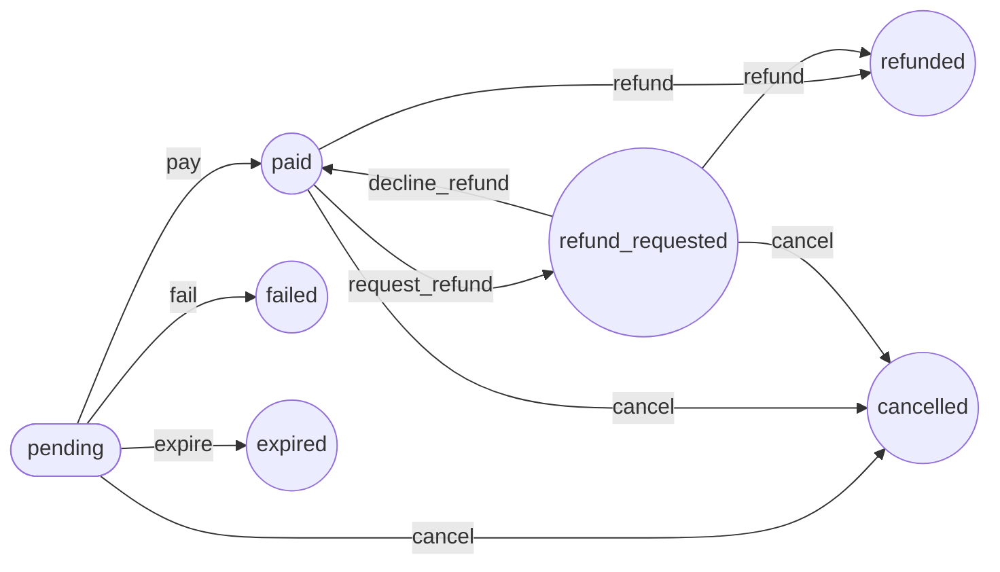

## BookingOccurrence (`booking_occurrence`)

One lesson inside a booking. Driven from inside the `Booking` aggregate, so its methods keep their own guards; `StateMachinesTest` pins them to this definition

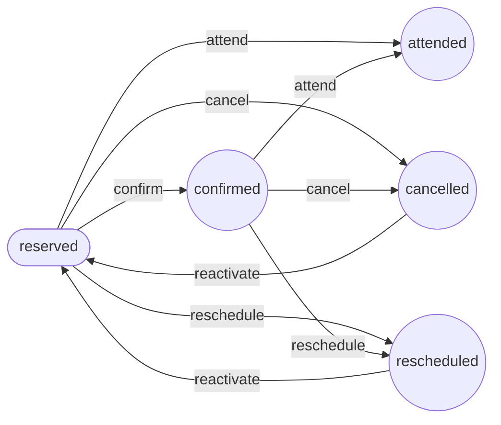

## Lesson (`lesson`)

Staff cancel / re-open a lesson (`ToggleLessonCancellation`)

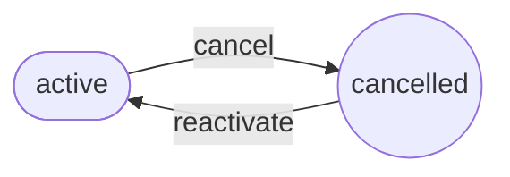

## WaitlistEntry (`waitlist_entry`)

Per-lesson FIFO queue; an `offered` seat is held for `OFFER_TTL_MINUTES`

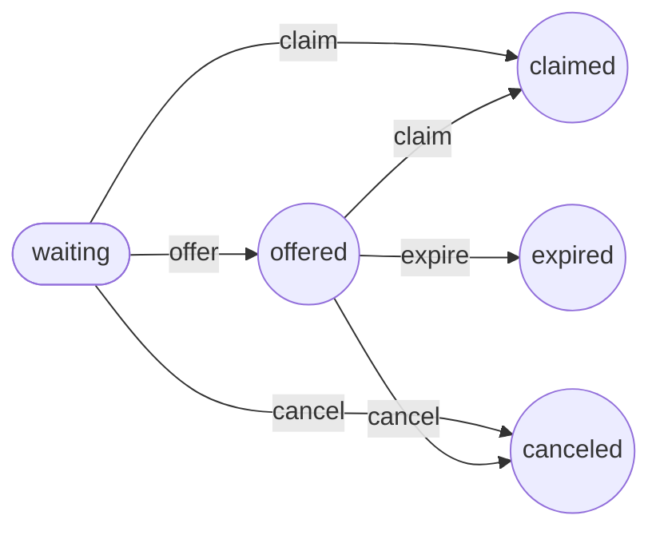

## Subscription (`subscription`)

Monthly ticket (flag `subscriptions`, off on prod)

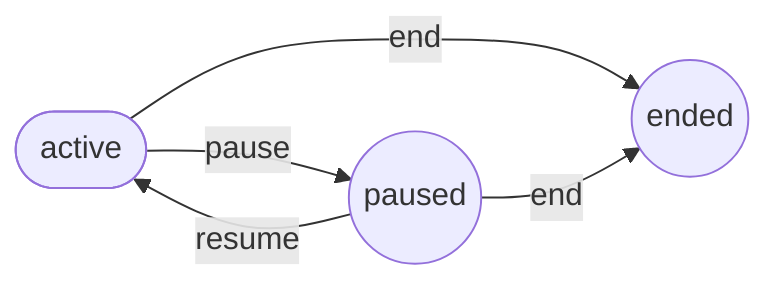

## RefundRequest (`refund_request`)

Admin decision on a refund; decided exactly once

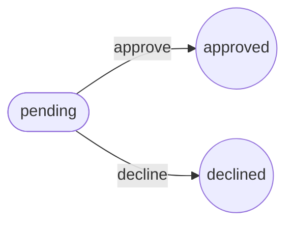

## CustomerOrder (`customer_order`)

Commerce order; `pay` is accepted late, `expire` never overrides `paid`

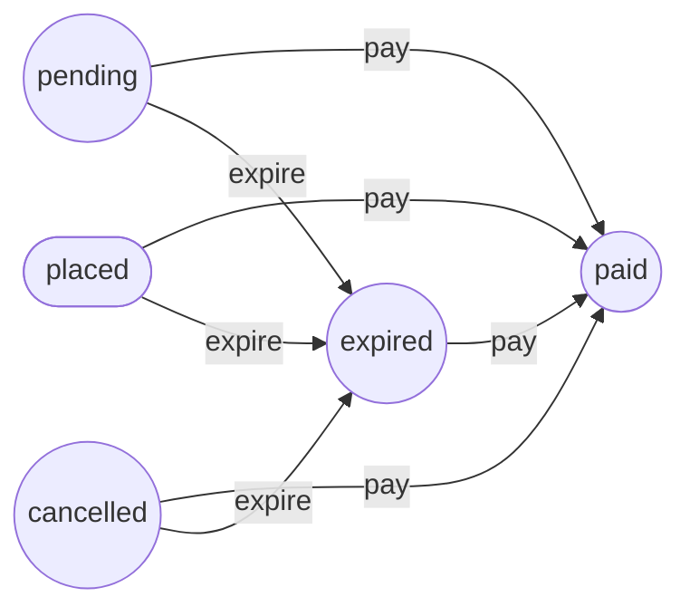

## Cart (`cart`)

Customer cart; `abandoned` is stored vocabulary nothing transitions into yet

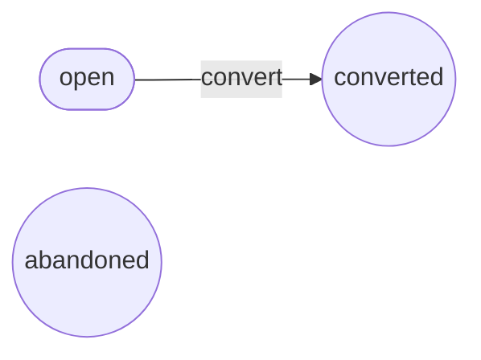

## PromotionRedemption (`promotion_redemption`)

Promo-code usage hold: consumed when the order is paid, released when it is lost

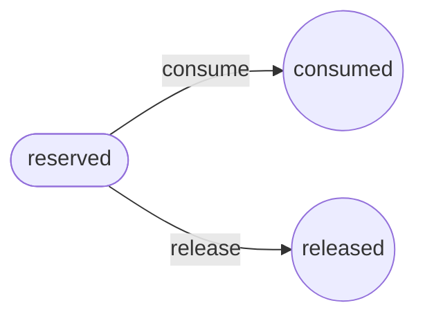

## PricingRule (`pricing_rule`)

Admin enables / disables a rule

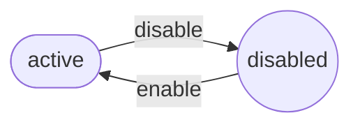
